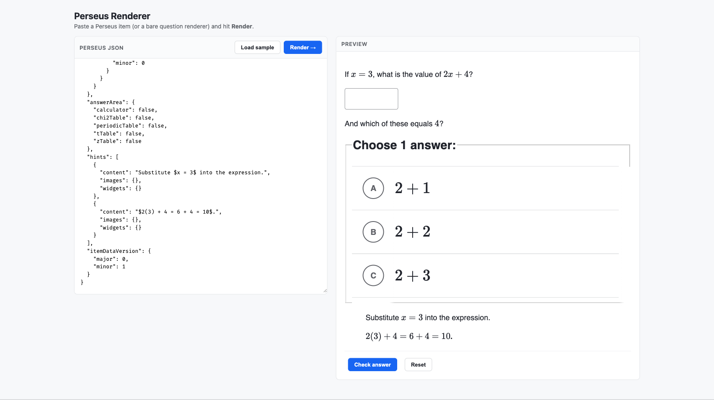

# Perseus Renderer

A tiny web app that renders [Khan Academy Perseus](https://github.com/Khan/perseus)
exercise JSON. Load a `.json` file containing a Perseus item (or an array of
items) and interact with each one in a two-column grid — including a **Check
answer** button that scores your input.



## Run it

```bash
git clone https://github.com/jennylihan/perseus-renderer.git
cd perseus-renderer
npm install
npm run dev
```

Then open http://localhost:5180.

```bash
npm run build     # production build into dist/
npm run preview   # preview the production build
```

> Requires Node 18+. The Khan Academy packages pin React to exactly `18.2.0`,
> so this app does too.

## What it accepts

Click **Choose .json file…** to load a file. The file can contain either a
single object or an array of objects, and each object can be either shape:

- **A full Perseus item** — `{ "question": {...}, "answerArea": {...}, "hints": [...] }`
- **A bare renderer** — just the `question` part: `{ "content": "...", "widgets": {...}, "images": {} }`
  (it gets wrapped into an item automatically).
- **A KA exercise export** — `{ "items": [{ "name": "...", "item_data": {...} }] }`;
  each `name` is shown as the card's label.
- **An exercise/problem-type export** — an array (or single object) of
  `{ "problemType": "...", "assessmentItems": [{ "itemData": "..." }] }`, where
  `itemData` is a JSON-encoded string (or an already-parsed object) of a full
  Perseus item. Every assessment item becomes its own card, and the sidebar
  groups cards under their `problemType` heading.

You can also click **Paste JSON…** and paste any of those shapes directly
(⌘/Ctrl+Enter renders). **Copy all JSON** and each card's **Copy JSON** copy the
item JSON back out exactly as it was loaded. Each card has **Check answer** /
**Reset** scoring and a **Show answer** toggle that reveals the solution.

Every item in the file is rendered as its own interactive card in a two-column
grid. Click **Load sample** (or just open the app) to load
[`public/items.json`](public/items.json), an example array of four items.

## How it's wired

The interesting bits, and why each is needed:

| File | Responsibility |
|------|----------------|
| [`src/main.tsx`](src/main.tsx) | Loads CSS (Perseus + Wonder Blocks tokens + MathJax), calls `init()` to register widgets, sets global `Dependencies`, and wraps the app in `<RenderStateRoot>`. |
| [`src/perseus-deps.tsx`](src/perseus-deps.tsx) | The `PerseusDependencies` (V1 + V2) objects Perseus requires, modeled on Perseus's own test harness but with a real MathJax `TeX` component. |
| [`src/tex.tsx`](src/tex.tsx) | Real math rendering via `@khanacademy/mathjax-renderer`. |
| [`src/PerseusItemRenderer.tsx`](src/PerseusItemRenderer.tsx) | Wraps `<ServerItemRenderer>` with the i18n context, the keypad context (for math-input widgets), and a Check/Reset UI that scores via `scorePerseusItem`. |
| [`src/App.tsx`](src/App.tsx) | The file picker + two-column grid of item cards. Reads the chosen `.json` file, normalizes a single item or an array into a list, and renders one `PerseusItemRenderer` per item. |

### Gotchas worth knowing (these took the most digging)

- **`Dependencies.setDependencies(...)` must be called once at startup**, and
  `<ServerItemRenderer dependencies={...}>` also needs the V2 deps.
- **`<PerseusI18nContextProvider strings={mockStrings} locale="en">`** is
  required, or the renderer throws `Cannot read properties of null (reading
  'strings')`. `mockStrings` comes from the `@khanacademy/perseus/strings`
  subpath.
- **`@khanacademy/wonder-blocks-tokens/styles.css` + `<RenderStateRoot>`** are
  both required, or Wonder Blocks components (e.g. the numeric input, radio
  choice layout) render unstyled/broken. Wonder Blocks now themes via CSS
  variables that live in that stylesheet.
- React is pinned to **exactly `18.2.0`** because several Wonder Blocks packages
  declare that as an exact peer dependency.
